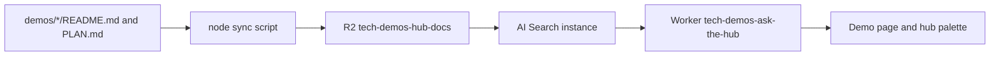

# Ask the Hub

Visitors ask questions about this monorepo. Cloudflare AI Search (formerly AutoRAG) answers from every demo's `README.md` and `PLAN.md`, which already live in git and are copied into R2. The Worker does not embed, chunk, or keep a vector index.

## MVP

A visitor opens the demo, passes the shared Turnstile widget, and asks a short question. The page streams an answer and lists the retrieved chunks with source file, score, and snippet. The hub gallery gets a card, a Command-K palette, a visible Search button, and a chat bubble. Those controls call this Worker and stay hidden if it does not answer.

Out of scope: creating the R2 bucket, the AI Search instance, or any deploy. The instance name in wrangler is `tech-demos-hub-docs`. Questions are not stored or logged.

## Flow



## Tasks

1. Sync script diffs by SHA-256, skips unchanged keys, and deletes removed demos only with `--prune`.
2. Worker: `POST /api/ask` streams `aiSearch`. `POST /api/search` returns chunks. Turnstile, per-IP rate limits, and a 200-ask UTC day cap sit in front.
3. Demo page and hub palette show the answer beside the chunks.
4. Tests for the cap, Turnstile, rate limit, input length, and sync diff. Playwright checks the demo and the palette at 390px.

## Stack

- Workers static assets for the page. The account is Workers Paid; no Containers and no Workers for Platforms.
- AI Search namespace binding `AI_SEARCH`. `env.AI_SEARCH.get(env.AI_SEARCH_INSTANCE)` talks to instance `tech-demos-hub-docs`. `chatCompletions({ stream: true })` streams the answer. `search` returns chunks. Zero Vectorize plumbing in this repo.
- R2 bucket `tech-demos-hub-docs` is filled by the sync script with the S3 API. Keys are `<slug>/README.md` and `<slug>/PLAN.md`.
- Durable Object class `AskCap`, binding `ASK_CAP`, one global SQLite counter. `blockConcurrencyWhile` makes the increment atomic.
- Rate limits `ASK_LIMIT` namespace `7614` (8 per minute per IP) and `SEARCH_LIMIT` namespace `7615` (20 per minute per IP). Both ids are unused in this repo. The next taken id before them is `7613`.
- Shared Turnstile site key `0x4AAAAAAFRUoj5qDpf7XyIW`. Dummy and localhost tokens pass only when `DEV=1`.

## Layout

```
demos/ask-the-hub/
  PLAN.md
  README.md
  wrangler.jsonc
  public/                 # page, css, client
  src/worker/             # fetch, cap, turnstile, search
  scripts/sync-docs.mjs   # node, idempotent
  scripts/check-layout.ts # Playwright at 390px
```

The hub card is `apps/hub/src/registry.ts`. The palette lives next to the gallery so the hub can hide it without taking the gallery down.
