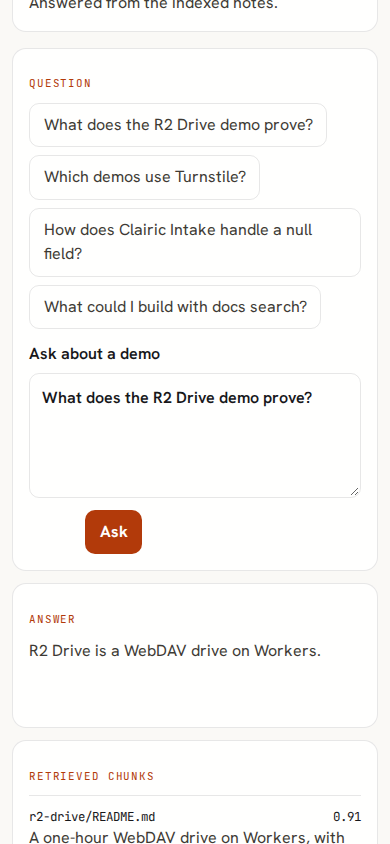
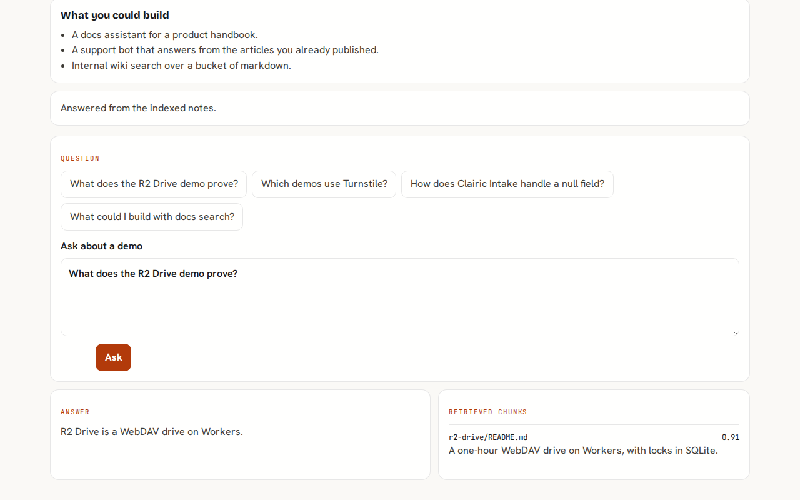
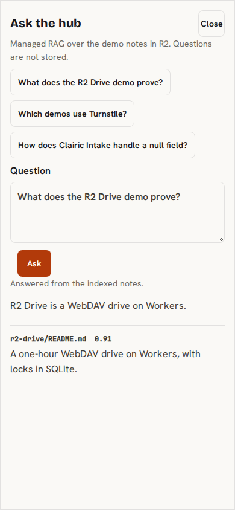

# Ask the Hub

Ask a question about the tech demos. Cloudflare AI Search reads every demo `README.md` and `PLAN.md` from the R2 bucket `tech-demos-hub-docs` and streams an answer. The Worker does not embed documents or keep its own vector index.

## What this proves

Managed RAG over R2, with zero vector plumbing.

## What you can try

- Ask what a demo proves, which demos use Turnstile, or how a null field is handled.
- Watch the answer stream while the retrieved notes stay beside it.
- Read the source file and the score on each chunk.

## What you could build

- A docs assistant for a product handbook.
- A support bot that answers from articles you already published.
- Internal wiki search over a bucket of markdown.

## Run

```sh
bun install
bun run --filter @tech-demos/ask-the-hub dev
```

`DEV=1` on that command accepts Cloudflare's dummy Turnstile token on localhost, and that same dummy token can be reused for later questions. Production leaves `DEV` empty, so dummy and localhost tokens are rejected, and a solved token stays limited to one search and the following ask. Set `TURNSTILE_SECRET` to the shared widget secret before a real deploy. This repo does not create the bucket, the AI Search instance, or the rate-limit namespaces.

Sync the notes when you are ready to index them:

```sh
R2_ACCOUNT_ID=... R2_ACCESS_KEY_ID=... R2_SECRET_ACCESS_KEY=... node demos/ask-the-hub/scripts/sync-docs.mjs --dry-run
R2_ACCOUNT_ID=... R2_ACCESS_KEY_ID=... R2_SECRET_ACCESS_KEY=... node demos/ask-the-hub/scripts/sync-docs.mjs
R2_ACCOUNT_ID=... R2_ACCESS_KEY_ID=... R2_SECRET_ACCESS_KEY=... node demos/ask-the-hub/scripts/sync-docs.mjs --prune
R2_ACCOUNT_ID=... R2_ACCESS_KEY_ID=... R2_SECRET_ACCESS_KEY=... node demos/ask-the-hub/scripts/sync-docs.mjs --prune --dry-run
```

Keys are `<slug>/README.md` and `<slug>/PLAN.md`. Unchanged files are skipped. Removed demos are deleted only with `--prune`. `--prune --dry-run` lists those deletions and does not delete them.

The Worker calls `env.AI_SEARCH.get(env.AI_SEARCH_INSTANCE)` on the namespace binding. `AI_SEARCH_INSTANCE` is `tech-demos-hub-docs`. This repo does not create that instance.

## Limits

- Question: trimmed, 1–500 characters. The text is not stored or logged.
- `ASK_LIMIT` namespace `7614`: 8 asks per minute per IP.
- `SEARCH_LIMIT` namespace `7615`: 20 searches per minute per IP.
- `AskCap` Durable Object: 200 asks per UTC day, and 1000 searches per UTC day, for the whole demo. Over either cap the API returns 429 and the time it resets, midnight UTC. A failed search gives that slot back.
- A solved Turnstile token is remembered once, for two minutes, and can be used twice (search, then ask). A third use is rejected. The expiry is not extended. Expired rows are deleted the next time a token is stored.

## Screenshots

Captured against a local stand-in backend, not the live AI Search instance.







The same local stand-in captured the other stills in [artifacts/](./artifacts/) and `artifacts/ask-the-hub.mp4`.
