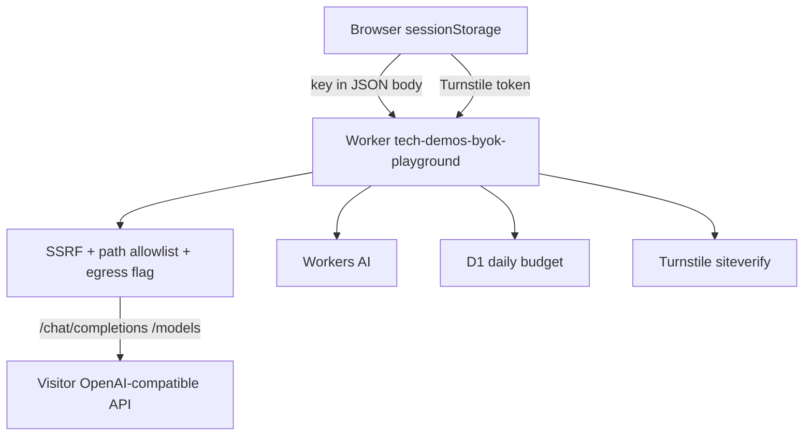

# Plan — byok-playground

## Goal

A visitor pastes an OpenAI-compatible API key, base URL, and model id, then streams chat, lists models, runs capability probes, and compares the same prompt against Workers AI — through a Worker that never stores the key and is not a general-purpose proxy.

## Single-user MVP

- In:
  - Browser-only key storage (`sessionStorage` by default, opt-in `localStorage`, Clear).
  - Worker proxy for `POST /chat/completions` (SSE passthrough) and `GET /models`, with the key in the JSON body.
  - Hard SSRF guard: https:443 (http://localhost only when `ENVIRONMENT=local`), no redirects, IP/hostname denylist including TSD and workers.dev, path allowlist, size/time caps, hop-by-hop and cookie stripping. DNS is best-effort; `global_fetch_strictly_public` is the egress backstop.
  - Same-origin + HMAC-signed session cookie (issued-at + network key, 12h; minted after one Turnstile pass when a site key is set) on every proxy call.
  - Per-network rate limits on namespaces 7461–7463 (`IPv4 /32`, `IPv6 /64`).
  - Side-by-side compare vs Workers AI, Turnstile action `compare`, atomic D1 daily budget with HMAC’d `ip_key`.
  - Capability checks: streaming, tools (`tool_calls`), JSON schema (required keys + nonce), vision (left pixel of a two-pixel image). A missing model is reported once. Otherwise inconclusive.
  - Served on `byok-playground.tech-demos.theserverless.dev`; the hub path 308s there.
  - Graphite & Ember UI, Contact CTA, hub registry card, tests, README, CHANGELOG.
- Out: accounts, key vaults, billing, Workers for Platforms, Containers, Browser Run, storing keys, arbitrary URL proxying.

## Tasks

1. SSRF, header allowlists, redaction, HMAC session cookie, origin check.
2. Proxy: chat SSE, list models, byte/time caps, per-network rate limits, response validation.
3. Compare path: validate first, then Turnstile action `compare`, D1 budget, Workers AI (stub when the binding is missing).
4. Capability probes with evidence-based pass / fail / unsupported / inconclusive.
5. Graphite & Ember UI, 390px layout, text-only model output.
6. Tests, mock OpenAI server, typecheck, screenshots, video, one PR. Do not deploy.

## Stack

- **Workers + Static Assets** — standalone Worker on the demo subdomain (hub path 308s there).
- **D1** — atomic daily compare budget only. No chat history.
- **Workers AI** — the “ours” side of compare. Local wrangler config omits the binding and uses a labelled stub.
- **Turnstile + rate limits 7461–7463** — session mint and compare are gated; every proxy route is limited per network key.
- **No Hono, no React.** Vanilla TS + Graphite & Ember CSS.

## Architecture

Worker `tech-demos-byok-playground`:

- `tech-demos.theserverless.dev/demos/byok-playground*` → 308
- `byok-playground.tech-demos.theserverless.dev/*`

## Cost

- Compare calls Workers AI with a small `max_tokens` cap.
- Global D1 daily cap plus per-`ip_key` cap.
- Visitor chat is billed to their key, not ours.
- No Durable Objects, R2, Queues, Containers, or Browser Rendering.

## Testing

- Unit tests: SSRF bypass cases, header stripping, key not in logs or errors, session HMAC, byte caps, capability pass semantics.
- `bun test` and `tsc`.
- Local mock OpenAI server + Workers AI stub for screenshots and a short video.

## Deferred

- DNS pinning for the full fetch (DoH is checked before fetch; TOCTOU remains; egress is the backstop).
- A live Workers Logs confirmation that request bodies are not captured (invocation logs are already off).
- A shared `@tech-demos/guardrails` package.
- Provider-specific auth schemes beyond `Authorization: Bearer`.
