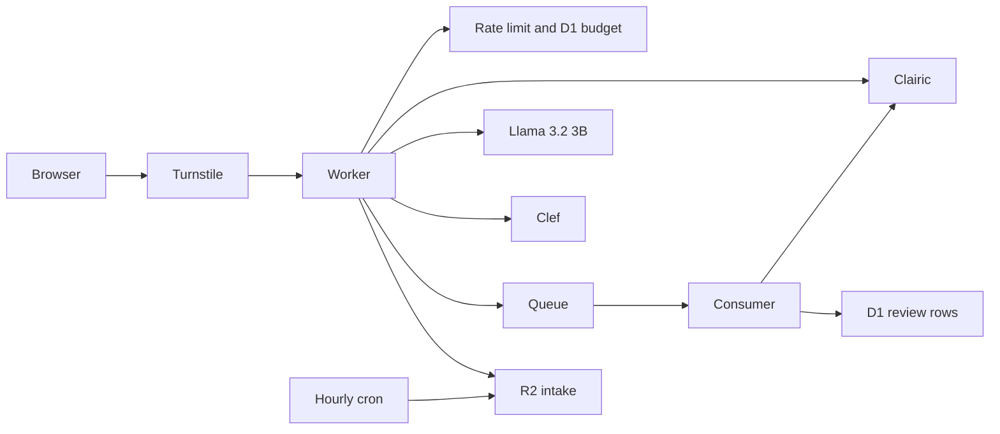

# Clairic Intake

A desk that turns a support email or a receipt photo into typed values. [Clairic](https://developers.cloudflare.com/workers-ai/models/clairic/) (`@cf/cloudflare/clairic`) reads the text, and up to one image in this demo, and returns one value per field. A missing value is null. Text values keep the character span they came from. Estimates and forecasts include an 80% range.

- **Plan:** [PLAN.md](./PLAN.md)
- **What changed:** [CHANGELOG.md](./CHANGELOG.md)

## What this proves

Reliable typed data from messy documents on Workers alone, with provenance and honest nulls. The same input can be sent to a small instruct model so you can see latency, whether the JSON matches the schema, and an estimated cost. Clef can then pick refund, escalate, or approve from the typed values rather than from the raw email.

## What you can try

- Paste the support email, the invoice, or the insurance claim, or upload the receipt photo.
- Switch presets (invoice, support ticket, insurance claim) or add and remove fields.
- Read the highlights, the nulls flagged for review, the estimate band, and the forecast chart.
- Compare Clairic with Llama 3.2 3B Instruct.
- Ask Clef for a decision. The reason is the winning policy line plus the probabilities.
- Run the 12-document sample inbox and accept or correct a row.

## What you could build

- Invoice intake that files a total only when the span and the confidence agree.
- Support triage that sends low-confidence or null fields to a person.
- Claims processing that estimates a reserve and forecasts the next payouts.

## How it works



The desk does not fetch URLs. Image bytes are sniffed. Rendered document text is escaped before it is inserted as HTML. Other text is assigned with `textContent`.

`bun run dev` sets `ENVIRONMENT=local` and uses a labelled mock, so tests and the local page do not bill Workers AI. `bun run dev:live` calls the real models and needs `wrangler login`. A timed-out `AI.run` is not cancelled, so a slow call can still be billed. Cost stays small: Clairic is $0.10 per million input tokens and does not charge for output.

## Local

```bash
cd demos/clairic-intake
bun install
cp .dev.vars.example .dev.vars
bun run dev
```

Open `http://127.0.0.1:8787/`. The test Turnstile widget passes on its own. Results are labelled mocks.

```bash
bun test
bun run typecheck
bun run smoke
```

`bun run dev:live` uses the real Workers AI binding and the always-pass Turnstile test widget. It needs `wrangler login`. The Worker name in `wrangler.live.jsonc` is `tech-demos-clairic-intake-dev`, so that command does not replace the production Worker. Try a text extract with and without compare, the receipt image, a Clef decision, and the sample inbox. A timed-out `AI.run` is not cancelled, so a slow call can still be billed.

## Deploy checklist

The D1 id in `wrangler.jsonc` is `472d5bac-dea1-4710-90d9-7b5738178b68` (`tech-demos-clairic-intake`). `wrangler.local.jsonc` and `wrangler.live.jsonc` keep `00000000-0000-4000-8000-000000007560` so local migrations apply without the remote database. Wrangler will not create a database whose id is all zeros; that local id is not all zeros.

1. **D1.** `tech-demos-clairic-intake` is already `472d5bac-dea1-4710-90d9-7b5738178b68` in `wrangler.jsonc`. On a new account, `wrangler d1 create tech-demos-clairic-intake`, put that id in `database_id`, then `wrangler d1 migrations apply DB --remote`.
2. **R2.** `wrangler r2 bucket create tech-demos-clairic-intake`, then the one-day lifecycle (not a wrangler.jsonc field):
   `wrangler r2 bucket lifecycle add tech-demos-clairic-intake intake-expiry intake/ --expire-days 1`
   The hourly cron also deletes objects older than a day.
3. **Queue.** `wrangler queues create tech-demos-clairic-intake` and `wrangler queues create tech-demos-clairic-intake-dlq`. The producer binding is `INTAKE`. The consumer reads the same queue, retries twice, waits 30 seconds between retries, and sends exhausted messages to the dead-letter queue. Nothing reads that queue. Inspect it in the dashboard within 4 days; messages there are deleted after that. A row that is still queued or running after the lease and the retry wait is shown as failed.
4. **Secrets.** `wrangler secret put TURNSTILE_SECRET` and `wrangler secret put IP_HASH_SECRET` (32 or more random bytes).
5. **Turnstile.** Use the shared widget (`docs/turnstile.md`). `TURNSTILE_SITE_KEY` is already that site key. The widget actions are `extract`, `decide`, and `batch`.
6. **DNS.** Add a proxied record for `clairic-intake.tech-demos.theserverless.dev`, or switch that route to a `custom_domain`.
7. **Deploy.** `bun run deploy`. Routes: `tech-demos.theserverless.dev/demos/clairic-intake*` and `clairic-intake.tech-demos.theserverless.dev/*`.
8. **AI.** The Worker uses `@cf/cloudflare/clairic`, `@cf/meta/llama-3.2-3b-instruct`, and `@cf/cloudflare/clef` through the Workers AI binding. No extra provider key. Confirm the account can call the two preview models before the first paid request.
9. **Live check.** Before deploy, run `bun run dev:live` once and try text extract with and without compare, the receipt image, decide, and batch.

Rate-limit namespace ids are 7503–7509 (7501 and 7502 are already used by partyserver). Each network gets 40 paid calls per UTC day. IPv6 is grouped by /64. A shared row caps the whole demo at 200 paid calls per day and returns 503 when it is used up. A batch of 12 counts as 12. A compare that fails still returns the Clairic result.
