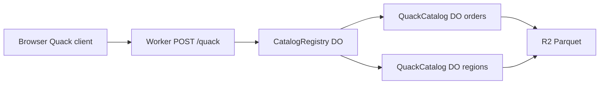

# Lake Catalog

A visitor picks a role, runs SQL, and watches a server-side policy allow, deny, or rewrite the statement. The page speaks DuckDB's Quack HTTP protocol to a Cloudflare Worker. One SQLite Durable Object holds each catalog. A registry Durable Object routes tokens and counts the daily cap. The sample rows also live as Parquet in R2.

## Gate

`@quack-protocol/sdk` 0.3.0 (Quack protocol version 3) round-trips `SELECT 42` against a tiny peer.

| Runtime | Default `fetch` | `fetch: (input, init) => globalThis.fetch(input, init)` |
| --- | --- | --- |
| Bun | Pass | Pass |
| Cloudflare Worker (`wrangler dev`, workerd) | Fail: `TypeError: Illegal invocation` | Pass, row `{ answer: 42 }` |
| Chrome | Fail: `Failed to execute 'fetch' on 'Window': Illegal invocation` | Pass, row `{ answer: 42 }` |

The SDK stores `globalThis.fetch` and calls it later, which drops `this` in a Worker and in the browser. The published `fetch` option is the adapter. This demo always passes that wrapper. No other protocol fallback is required.

## MVP

One read-only `orders` catalog and a smaller `regions` catalog. Roles are `analyst`, `viewer`, and `guest`. A short-lived JWT is the Quack auth string. The page shows the decision, the reasons, the SQL that actually ran, the result rows, the catalog-to-Durable-Object map, and a DuckDB CLI snippet.

Out of scope: creating the R2 bucket, setting secrets, or deploying. No OIDC, no admin API, no trusted-client R2 leases, and no full DuckDB catalog shim. The Worker is not a DuckDB server.

## Flow



## Tasks

1. Policy function: one SELECT, read-only, role decides allow, deny, or rewrite, with reasons and the SQL to run.
2. Quack codec on `POST /quack` using `@quack-protocol/sdk`, JWT in the connection auth string, explain on `x-lake-explain`.
3. `CatalogRegistry` charges a UTC-day cap and names each catalog. `QuackCatalog` stores the table in SQLite. The midnight cron writes Parquet. Requests only read R2, and only when the table is empty or the day marker is stale.
4. Page: role, sample SQL, Turnstile, result, explain, Durable Object map, CLI snippet.
5. Nightly cron reseeds both catalogs. Tests cover policy, JWT, the Quack round trip, the cap, Turnstile, and layout at 390px.

## Stack

- Workers static assets plus two SQLite Durable Objects. Workers Paid. No Workers for Platforms and no Containers.
- `@quack-protocol/sdk` 0.3.0 for the binary protocol. The browser bundle and the Worker both pass a bound `fetch`.
- `hyparquet` 1.31.5 and `hyparquet-writer` 0.17.0 write and read the sample Parquet. Versions are old enough for the repo install age gate.
- R2 binding `LAKE`, bucket name `tech-demos-lake-catalog` (placeholder until the owner creates it).
- Rate limits `QUERY_LIMIT` namespace `7621` (12 per minute per IP), `TOKEN_LIMIT` namespace `7622` (8 per minute), `READ_LIMIT` namespace `7623` (60 per minute). The highest id already in this repo is `7615`.
- Daily cap of 400 queries in `CatalogRegistry`. Cron `0 0 * * *` reseeds the catalogs.
- Shared Turnstile site key `0x4AAAAAAFRUoj5qDpf7XyIW`. Dummy tokens pass only when `DEV=1`.

## Layout

```
demos/lake-catalog/
  PLAN.md
  README.md
  CHANGELOG.md
  wrangler.jsonc
  public/                 # page, css, bundled client
  src/shared/             # policy, rows, parquet, jwt
  src/worker/             # fetch, DOs, Quack, Turnstile
  src/client/app.ts
  scripts/check-layout.ts
  scripts/verify-selfhost.ts
```

The hub card is `apps/hub/src/registry.ts`.
