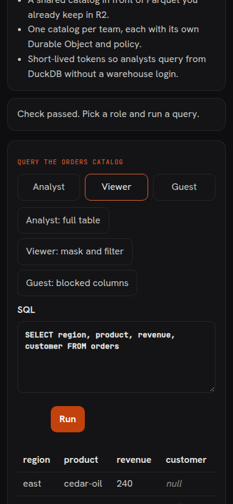
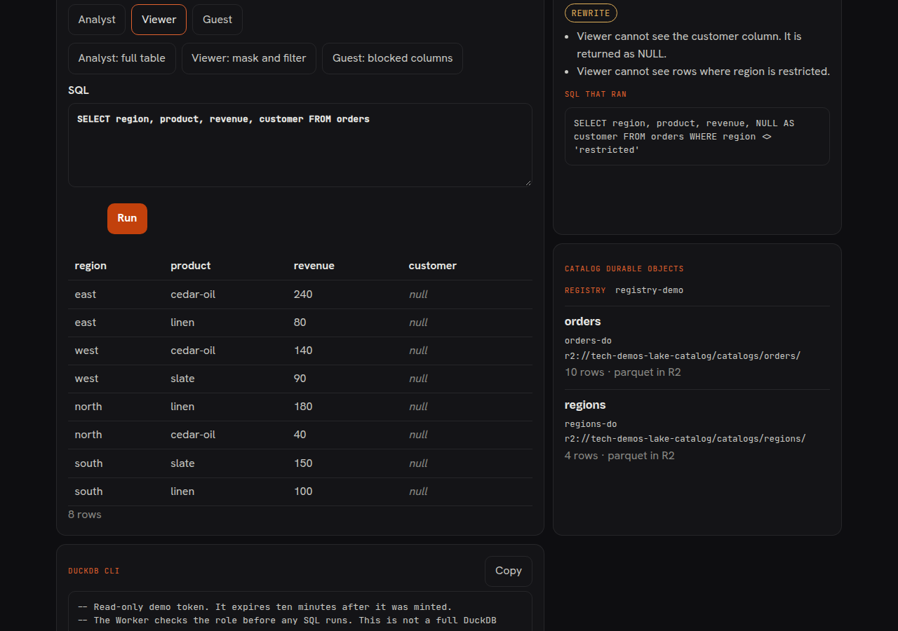

# Lake Catalog

Pick analyst, viewer, or guest and run SQL. The Worker speaks DuckDB’s Quack HTTP protocol, checks the role against a server-side policy, and returns the rows. Each catalog is its own SQLite Durable Object. A registry object routes tokens and counts the daily cap. The sample rows are also a Parquet file in R2.

This demo follows the shape of [quacklake](https://github.com/tobilg/quacklake) (MIT, alpha). It is not a drop-in of that project and it is not a full DuckDB server.

## What this proves

A lakehouse catalog can sit on Workers Paid: Quack on `POST /quack`, one Durable Object per catalog, JWT roles, and Parquet in R2.

## What you can try

- Run the analyst sample and read every column, including the restricted rows.
- Run the viewer sample and see `customer` come back as null, with the restricted region removed.
- Run the guest sample and see the statement denied before it runs. A guest query that only names public columns still drops `restricted` rows, and a filter on `customer` or `revenue` is denied.
- Read the side panel: registry id, each catalog’s Durable Object id, and the `r2://` data path.
- Copy the DuckDB CLI snippet. The token is read-only and expires in ten minutes.

## What you could build

- A shared catalog in front of Parquet you already keep in R2.
- One catalog per team, each with its own Durable Object and policy.
- Short-lived tokens so analysts query from DuckDB without a warehouse login.

## Run

```sh
bun install
bun run --filter @tech-demos/lake-catalog dev
```

`DEV=1` accepts Cloudflare’s dummy Turnstile token on localhost. Production leaves `DEV` empty. Set these Worker secrets before a real deploy. This repo does not create them:

- `TURNSTILE_SECRET` — the existing `tech-demos-shared` widget secret
- `QUACK_JWT_SECRET` — HS256 key for demo tokens
- `CONNECTION_SIGNING_SECRET` — HMAC key for Quack connection ids

Create the R2 bucket `tech-demos-lake-catalog` and bind it as `LAKE` before deploy. The name in `wrangler.jsonc` is a placeholder. The nightly cron `0 0 * * *` is the only path that writes Parquet. A request reads R2 only when the SQLite table is empty or its UTC day marker is stale. The catalog map is built from the sample ids and counts, so opening the page does not wake a Durable Object.

## Limits

- One `SELECT` from `orders` or `regions`. No comments, no second statement, no writes.
- `QUERY_LIMIT` namespace `7621`: 12 statements per minute per IP. Connection, fetch, and heartbeat frames are not counted.
- Turnstile siteverify must name `lake-catalog.tech-demos.theserverless.dev` or `tech-demos.theserverless.dev` and the action `lake-catalog`. A missing `TURNSTILE_SECRET` returns 503.
- `TOKEN_LIMIT` namespace `7622`: 8 token mints per minute per IP.
- `READ_LIMIT` namespace `7623`: 60 map reads per minute per IP.
- `CatalogRegistry`: 400 queries per UTC day for the whole demo. Over the cap the Quack error says it resets at midnight UTC.
- The page logs the role and the decision. It does not log the SQL.

## Quack client

`@quack-protocol/sdk` 0.3.0 works from a Worker and from Chrome when `fetch` is passed as `(input, init) => globalThis.fetch(input, init)`. The default client stores `fetch` and calls it later, which throws `Illegal invocation` in both places. The page and the tests use that wrapper.

The CLI snippet uses `INSTALL quack FROM core_nightly`. DuckDB may send catalog SQL this Worker does not implement. The supported client is the query box on the page.

## Screenshots

Captured against the local catalog, not a deployed bucket.




