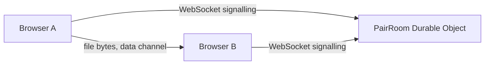

# Pairlane

A browser sends a file straight to another browser. A Cloudflare Durable Object only introduces the two peers. The file moves on a WebRTC data channel and never reaches the Worker.

Inspired by [kiyo-e/pairlane](https://github.com/kiyo-e/pairlane) (MIT). This folder is an original demo of that pattern, not a copy of the upstream source. See [CHANGELOG.md](./CHANGELOG.md) and [NOTICE.md](./NOTICE.md).

## MVP

A visitor passes the shared Turnstile widget, creates a room, and gets a short link plus a QR code. A second browser opens the link. Either side picks a file. Both sides show progress, speed, and a SHA-256 check. A side panel lists what the Durable Object sees: joins, offers, answers, and ICE candidates. It never lists file bytes.

Out of scope: deploying, creating Cloudflare resources, a CLI, more than two peers, and end-to-end encryption. TURN is optional and off unless three secrets are set.

## Flow



## Tasks

1. `POST /api/rooms` checks Turnstile, a per-IP limit, and a UTC-day cap, then opens a room that expires in 10 minutes.
2. `PairRoom` accepts two WebSockets, relays offer / answer / ICE, and keeps a short tape of those events.
3. The page renders the link, a QR code, progress, speed, and the tape. At 390px the tape stacks under the file control.
4. Tests cover admission, signal parsing, the cap, Turnstile hosts, and the data-channel framing. Playwright checks 390px. `verify:selfhost` dry-runs the Worker bundle.

## Stack

- Workers static assets and one Worker. Workers Paid. No Containers and no Workers for Platforms.
- Durable Object `PairRoom`, binding `ROOM`, SQLite class, hibernated WebSockets, alarm at 10 minutes.
- Durable Object `CreateCap`, binding `CREATE_CAP`, one global SQLite counter and the set of live room ids. Guessed ids never wake `PairRoom`.
- Rate limits `CREATE_LIMIT` namespace `7624` (4 per minute per IP), `CONNECT_LIMIT` namespace `7625` (20 per minute per IP), `READ_LIMIT` namespace `7626` (60 per minute per IP). ask-the-hub uses `7615`. lake-catalog takes `7621`–`7623`.
- Shared Turnstile site key `0x4AAAAAAFRUoj5qDpf7XyIW`. The dummy token passes only when `TURNSTILE_LOCAL=1` and the secret is Cloudflare's test secret.
- ICE uses `stun:stun.cloudflare.com:3478`. Optional `TURN_URLS`, `TURN_USERNAME`, and `TURN_CREDENTIAL` append a TURN server. The demo runs without them.
- QR codes from `uqr` (MIT), bundled into the page.

## Layout

```
demos/pairlane/
  PLAN.md
  README.md
  CHANGELOG.md
  NOTICE.md
  wrangler.jsonc
  public/
  src/shared/     # ids, signals, cap SQL, ICE, file framing
  src/worker/     # fetch, Turnstile, PairRoom, CreateCap
  src/client/     # page, data channel, QR
  scripts/check-layout.ts
  scripts/verify-selfhost.ts
```

The hub card is `apps/hub/src/registry.ts`.
