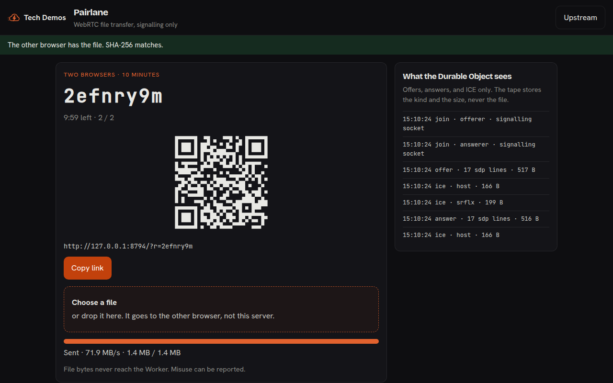
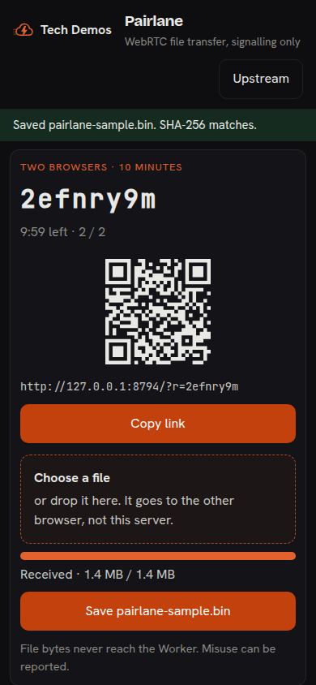

# Pairlane

Send a file straight from one browser to another. A Durable Object only introduces the two peers. Inspired by [kiyo-e/pairlane](https://github.com/kiyo-e/pairlane) (MIT). This folder is an original demo of that pattern. See [CHANGELOG.md](./CHANGELOG.md) and [NOTICE.md](./NOTICE.md).

- **Live:** <https://tech-demos.theserverless.dev/demos/pairlane/>
- **Subdomain:** <https://pairlane.tech-demos.theserverless.dev/>
- **Plan:** [PLAN.md](./PLAN.md)

## What this proves

A Durable Object can be a WebRTC signalling room and nothing else. Offers, answers, and ICE candidates pass through `PairRoom`. The file moves on a browser data channel. The side panel is the tape of what the object saw.

## What you can try

- Create a room after the Turnstile check. Copy the short link or scan the QR code.
- Open the link on a phone, or in a second tab, and send a file either way.
- Watch progress and transfer speed, then the SHA-256 check.
- Read the side panel. It lists joins, offers, answers, and ICE types. It does not list file bytes.

## What you could build

- A support handoff that receives a screenshot without storing it.
- A classroom drop where the laptop is the only destination.
- A phone-to-desk scan that never lands in an upload bucket.

Rooms last 10 minutes and hold two peers. Misuse can be reported.

## Run

```sh
bun install
bun run --filter @tech-demos/pairlane dev
```

The dev script sets Cloudflare's always-pass Turnstile site key and `TURNSTILE_LOCAL=1`. Copy `.dev.vars.example` to `.dev.vars` so the matching test secret is present. Production leaves `TURNSTILE_LOCAL` empty and uses the shared widget. Set `TURNSTILE_SECRET` to that widget's secret before a real deploy. This repo does not create the Worker, the Durable Objects, or the rate-limit namespaces.

## Limits

- Two peers. A third connection is closed.
- The room alarm fires 10 minutes after creation and drops both sockets.
- `CREATE_LIMIT` namespace `7624`: 4 room opens per minute per IP.
- `CONNECT_LIMIT` namespace `7625`: 20 signalling sockets per minute per IP.
- `READ_LIMIT` namespace `7626`: 60 reads per minute per IP.
- `CreateCap`: 240 rooms per UTC day for the whole demo. Over the cap the API returns 429 and midnight UTC.
- Files are capped at 256 MB in the browser. The Worker never receives them.
- ICE uses `stun:stun.cloudflare.com:3478`. A symmetric NAT can fail with STUN alone. TURN is optional.

## TURN

Leave TURN unset and the demo still runs. Same-network and many home NATs connect with Cloudflare's STUN server. If two networks cannot punch a hole, set these Worker secrets and redeploy:

| Secret | Example |
| --- | --- |
| `TURN_URLS` | `turn:turn.cloudflare.com:3478?transport=udp,turns:turn.cloudflare.com:5349?transport=tcp` |
| `TURN_USERNAME` | username from your TURN provider |
| `TURN_CREDENTIAL` | credential from your TURN provider |

Cloudflare Realtime can mint a short-lived credential. It is not required, and the values expire, so refresh them when they stop working:

```sh
curl -X POST "https://rtc.live.cloudflare.com/v1/turn/keys/$TURN_KEY_ID/credentials/generate" \
  -H "Authorization: Bearer $TURN_KEY_API_TOKEN" \
  -H "Content-Type: application/json" \
  -d '{"ttl": 86400}'
```

The Worker gives those three values only to browsers that have joined a room. Do not commit them. The page CSP already allows the `stun:`, `stuns:`, `turn:`, and `turns:` schemes, so a configured server does not need a code change.

## Screenshots





A two-tab transfer is in [artifacts/transfer.mp4](./artifacts/transfer.mp4).
