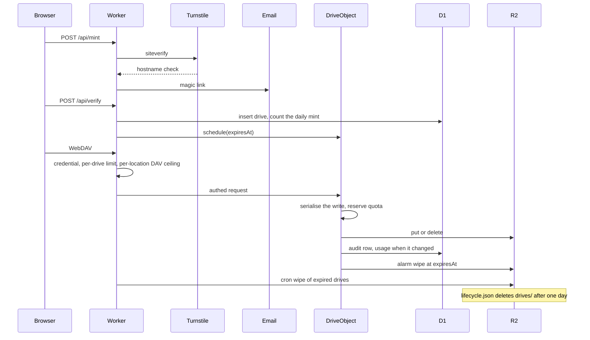

# R2 Drive

A short-lived sandbox for testing WebDAV with small documents. Class 1 and Class 2 (including `LOCK` / `UNLOCK`) run against an isolated R2 prefix, with lock state in a SQLite Durable Object. Only text, PDF and office documents are accepted. Drives are private and wiped within an hour. Misuse can be reported, and drives can be frozen.

What you can try: verify an email, accept the notice, and mount the drive from macOS Finder, Windows Explorer, rclone, or Obsidian Remotely Save. The page also uploads, renames, deletes, and previews text and PDF, and it shows the lock owner, timeout, and depth on a live request log.



What you could build with the same pattern: a personal Dropbox-style drive, an Obsidian or Zotero sync target, or a backup destination for rclone.

This demo is a port of [abersheeran/r2-webdav](https://github.com/abersheeran/r2-webdav) (Apache-2.0). See `NOTICE`, `LICENSE`, and `CHANGELOG.md`. The sandbox limits are in [SAFETY.md](./SAFETY.md).

## Run

From the repo root:

```sh
bun install
bun run --filter @tech-demos/r2-drive dev
```

That listens on <http://127.0.0.1:8808>. Local dev writes `.dev.vars` with Cloudflare's published Turnstile test pair and `EMAIL_SINK=1`. Open the page, mint with any non-disposable address, then use **Use the latest link**. The dev mailbox is served only on loopback, and only when both `EMAIL_SINK=1` and `TURNSTILE_LOCAL=1`.

```sh
bun run --filter @tech-demos/r2-drive test
bun run --filter @tech-demos/r2-drive typecheck
bun run --filter @tech-demos/r2-drive smoke
```

`smoke` expects the dev server. The repo-root `bun test` script lists other demos explicitly and does not include this one.

## Placeholders

Nothing here is deployed. Replace these before a real deploy:

| Binding | Placeholder |
| --- | --- |
| D1 `DB` | `database_id` `00000000-0000-4000-8000-0000000000d2`, name `r2-drive-placeholder` |
| R2 `BUCKET` | `r2-drive-placeholder` |
| Turnstile | `TURNSTILE_SITE_KEY` is empty in `wrangler.jsonc`. Secret `TURNSTILE_SECRET` |
| Email Sending | `MAIL_FROM` is `drive@example.invalid`. Binding `EMAIL` |
| Audit | secrets `AUDIT_KEY` and `AUDIT_HMAC_KEY`, each 32 bytes hex |
| Admin | secret `ADMIN_TOKEN` |

`MINT_ENABLED` is `"false"` in `wrangler.jsonc`. `envMintEnabled` is true only for the string `"true"`. Local `bun run dev` passes `--var MINT_ENABLED:true`. Turn it on in the deploy environment when the placeholders below are real. An admin can still turn minting off at runtime, and cannot turn it on while the env value is not `"true"`.

Deploy applies the R2 backstop after the Worker upload. Replace the bucket name first:

```sh
bun run --filter @tech-demos/r2-drive deploy
```

That runs `bunx wrangler r2 bucket lifecycle set r2-drive-placeholder --file lifecycle.json`. The same command is `bun run --filter @tech-demos/r2-drive lifecycle`.

The rule expires objects under `drives/` after one day. R2 lifecycle is day-scale, so the hour is enforced by the request path, the Durable Object alarm, and the `*/5` cron. The lifecycle rule is the backstop if those miss. Bytes can linger until the daily rule runs; they are not readable without the dead credential.

## Caps and content

25 MB per drive, 5 MB per file, 200 objects, one hour. `PUT` walks one list in `src/shared/content-policy.ts`. Text, Markdown, JSON, CSV, and PDF are allowed. Office files are allowed only when every ZIP part is `.xml` or `.rels`, inflates under 1 MB, and is UTF-8 XML with no armour and no long single-line base64 or hex run. The end-of-central-directory record must sit at the last 22 bytes, with no comment, and the central directory must describe exactly those parts. Zip64 and data descriptors are rejected. Images, video, audio, archives, OLE, and encrypted or unknown binaries are rejected with 415.

Finder `._*` files must start with the AppleDouble magic `00 05 16 07`, and `.DS_Store` must start with `00 00 00 01 Bud1`. Both stay under 64 KB, and a blocked signature of 4 or more bytes anywhere in the body is rejected.

A PDF must end with `%%EOF` followed only by whitespace. Signatures of 4 or more bytes are rejected anywhere in the body. Names are checked after `#xx` escapes are decoded, including `/EmbeddedFile`, `/JavaScript`, `/JS`, `/Launch`, and `/RichMedia`. Two- and three-byte markers are not scanned, so a Flate stream can contain `MZ` by chance. A name hidden inside a compressed `/ObjStm` is not decoded. Wrapped base64 or hex, and other encodings, can still pass as text. A long single-line mixed base64 or hex run is rejected.

The disposable-domain check uses a vendored copy of [disposable-email-domains](https://github.com/disposable-email-domains/disposable-email-domains) (`disposable_email_blocklist.conf`, CC0) plus a local denylist that includes `lomvic.com` (the temp-email demo). It is a **soft signal**: the list is incomplete and it can mis-label a real domain. A parent domain match counts, so `a.mailinator.com` and `email.lomvic.com` are rejected.

## Litmus

`src/shared/litmus-results.ts` holds a real run of litmus 0.13 (Ubuntu 0.13-5build2) against `wrangler dev` on 2026-10-23, after the archive and lock changes. The suites were invoked one at a time: `basic` at 17:54:22Z (16/16, one warning about DELETE of a collection whose Request-URI included a fragment), `copymove` at 17:55:32Z (13/13), `props` at 17:56:45Z (30/30), `locks` at 17:57:56Z (41/41), and `http` at 17:59:07Z (4/4, including `expect100`). The page prints those counts and the raw output; it does not invent a suite that has no raw output.

## Mount

After verify, the page prints snippets for Finder, `net use`, rclone, and Obsidian. The username is the drive id. The password is shown once on that page and is not saved in the browser. There is no public URL for a file. `/demos/r2-drive*` on the shared host redirects to `https://r2-drive.tech-demos.theserverless.dev` with 308. The session cookie is `__Host-r2drive_session`.
