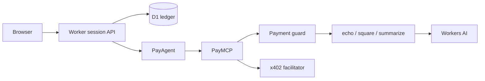
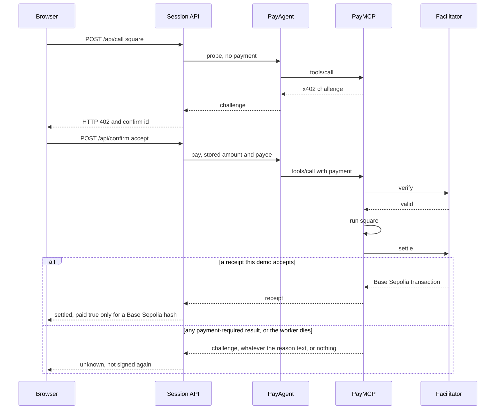

# Setup

Do this when you are ready to run the demo for real. Nothing in this folder creates Cloudflare resources or a wallet.

The page works before this setup. Paid tools then say setup is pending and `paid` stays false.

`wrangler dev` rewrites the request host to the zone route. Local mode is `LOCAL_DEV=1` on a loopback host, or on that rewritten host when the request has no `CF-Ray`. A request that reached Cloudflare has `CF-Ray`, so the flag does not enable the test token there.

## Architecture



The browser talks only to the session API. PayAgent and PayMCP are Durable Objects and are not mounted on a public path. The signing key is read inside PayAgent and is not written to D1, agent state, logs, or the response.

## Payment



A deny, an expiry, a bad binding, a failed tool, or a mock receipt stops before `paid: true`. A second confirm returns the stored row and does not call settle again.

## Crash after settle

Settlement happens inside PayMCP, after the tool runs. If the worker dies after that, the ledger does not know whether the facilitator submitted the transfer. The same gap exists for every payment-required result from that owned pay. `agents@0.33.0` returns `success: false` as `paymentRequired(errorReason)` and passes the reason through verbatim, including an empty string, `PAYMENT_REQUIRED`, and `INVALID_PAYMENT`. A thrown settle, including an HTTP 500, becomes `paymentRequired("SETTLEMENT_FAILED")`. None of those strings prove the transfer was not submitted, and the transaction is omitted. A success receipt with the wrong network or a hash this demo does not accept does not prove that either. The quote probe is a different call: it returns HTTP 402 before signing. A handler error with no payment-required payload stays `failed`, because the SDK skips settle. Every other owned-pay result becomes `unknown` with `paid: false` and the label "Outcome unknown. It may have settled on Base Sepolia. Not retried." The stored text is that sentence, not the raw x402 error JSON. A later confirm does not sign again. A later failed result does not replace `unknown`. Only a receipt this demo accepts as settled does. A settled row stays settled.

Do not start a second payment to find out. Look up the payer address on a Base Sepolia explorer.

## Storage

Each visit adds D1 rows: a session, timeline events, confirmations, a daily counter, and, after a payment, a fingerprint. PayAgent and PayMCP also keep SQLite for the life of the Durable Object. `purgeExpiredRows` in `src/worker/retention.ts` can delete D1 sessions, timeline rows, and confirmations whose session has been expired for 24 hours, and fingerprints older than 24 hours. It is unit tested and it is not scheduled. It does not delete Durable Object storage. Do not enable a cron, and do not run a remote delete, until that cleanup is authorized in chat. This demo does not create those resources and does not delete anything remote.

## Resources to create

| Name | Kind | Binding |
| --- | --- | --- |
| `tech-demos-x402-pay` | Worker | the script in this folder |
| `tech-demos-x402-pay` | D1 | `DB` |
| `PayMCP` | SQLite Durable Object | `PAY_MCP` |
| `PayAgent` | SQLite Durable Object | `PAY_AGENT` |
| Workers AI | binding | `AI` |
| `SESSION_LIMIT` | Rate limit namespace `7631` | 6 per minute |
| `CALL_LIMIT` | Rate limit namespace `7632` | 20 per minute |
| `CONFIRM_LIMIT` | Rate limit namespace `7633` | 10 per minute |
| `READ_LIMIT` | Rate limit namespace `7634` | 60 per minute |

`wrangler.jsonc` binds `DB` to D1 `tech-demos-x402-pay`, id `1c71bfc7-6f35-426d-8502-c483d81e62e5`. Do not point it at another demo's database.

Routes, already declared:

- `tech-demos.theserverless.dev/demos/x402-pay`
- `tech-demos.theserverless.dev/demos/x402-pay/*`
- `x402-pay.tech-demos.theserverless.dev/*`

## Secrets

Set these on the Worker. Use a new disposable Base Sepolia key. Do not reuse a key from another demo, and do not put the values in a file.

| Secret | What it is |
| --- | --- |
| `TURNSTILE_SECRET` | Secret for the existing widget `tech-demos-shared` |
| `X402_PAYEE_ADDRESS` | Base Sepolia address that receives test USDC. Not the zero address and not `0x0000000000000000000000000000000000000402` |
| `X402_CLIENT_PRIVATE_KEY` | `0x` plus 64 hex characters. Disposable testnet key. The payer signs an EIP-3009 authorization. The facilitator submits it, so this key does not need test ETH for gas. It needs test USDC for the two prices |

The shared Turnstile site key is already in config: `0x4AAAAAAFRUoj5qDpf7XyIW`. Action: `x402-pay`. Add that action on the existing widget if siteverify should require it. Hostnames that pass: `x402-pay.tech-demos.theserverless.dev`, `tech-demos.theserverless.dev`.

Suggested commands, after `wrangler login`, from this folder. The D1 database already exists.

```sh
npx wrangler d1 migrations apply DB --remote
printf '%s' "$TURNSTILE_SECRET" | npx wrangler secret put TURNSTILE_SECRET
printf '%s' "$X402_PAYEE_ADDRESS" | npx wrangler secret put X402_PAYEE_ADDRESS
printf '%s' "$X402_CLIENT_PRIVATE_KEY" | npx wrangler secret put X402_CLIENT_PRIVATE_KEY
```

Fund the disposable key with Base Sepolia test USDC. The payer does not send the transfer, so test ETH is not required for gas. The asset the facilitator settles is Circle test USDC `0x036CbD53842c5426634e7929541eC2318f3dCF7e`. Square needs `10000` atomic units ($0.01). Summarize needs `20000` ($0.02). Leave the production vars as they are: `LOCAL_DEV` is `"0"`. Do not set `X402_MODE` or `MOCK_FACILITATOR_ORIGIN` on the deployed Worker. If either is set on a public host, `/api` returns 503 `mock_misconfigured` and nothing is signed. PayAgent and PayMCP do not see `CF-Ray`; they rely on that refusal.

## What stays off

- No mainnet USDC and no mainnet chain id. The Worker rejects them.
- No user wallet and no field that asks for a seed or a private key.
- Live settlement is not claimed by the tests unless `X402_LIVE_TEST=1` and both payment secrets are in the environment. Otherwise that case is skipped.
