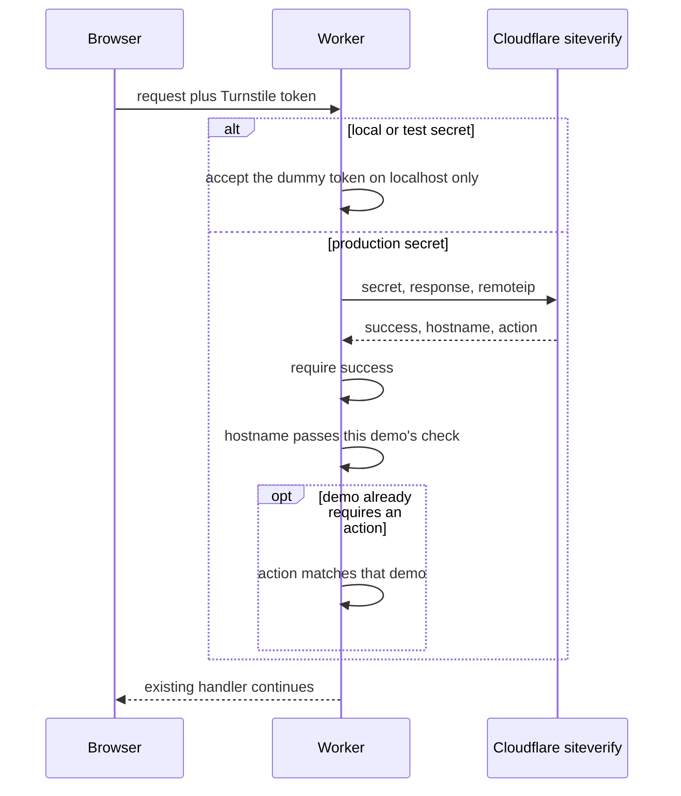

# Shared Turnstile widget

Every demo on `theserverless.dev` uses one Turnstile widget. The account is at its widget limit, so a new demo must not create another widget.

| | |
| --- | --- |
| Widget | `tech-demos-shared` (the existing `tech-demos-repo-per-agent` widget) |
| Site key | `0x4AAAAAAFRUoj5qDpf7XyIW` |
| Secret | `TURNSTILE_SECRET`, set on the Worker at deploy. Never commit it. |

The widget's domains include `theserverless.dev`, which covers `tech-demos.theserverless.dev` and every `*.tech-demos.theserverless.dev` host. They also include `localhost`, `127.0.0.1`, and `theserverlessdev.workers.dev`.

`temp-email` is the exception. It serves `email.lomvic.com` and keeps its own widget. `r2-drive` is switched to this key at deploy, outside this repo change.

Local wrangler configs (`wrangler.local.jsonc`, `wrangler.live.jsonc`, `wrangler.dev.jsonc`, `wrangler.offline.jsonc`, and `.dev.vars`) stay on Cloudflare's always-pass test site key `1x00000000000000000000AA` and the matching test secret. That pair is rejected off local mode.

## Why one widget

Siteverify checks the token with the widget secret. Every Worker that uses this site key must use that same secret. A token solved on one demo can therefore pass siteverify on another demo. That is accepted. Do not add a new per-demo action or a tighter hostname allowlist to stop it.

Demos that already require an action keep that check, and the client keeps rendering the widget with the same action. Actions are at most 32 characters from `[A-Za-z0-9_-]`. A new demo does not need an action.

Hostname checks stay as each demo already implements them. A new demo should accept:

- `theserverless.dev`
- any hostname ending in `.theserverless.dev`
- `localhost` and `127.0.0.1` only while local or test credentials are in use

Do not match a suffix of an unrelated domain.

## Add a demo

1. Put `TURNSTILE_SITE_KEY` = `0x4AAAAAAFRUoj5qDpf7XyIW` in the production `wrangler.jsonc` `vars`.
2. Leave local and test configs on `1x00000000000000000000AA`.
3. Call siteverify from the Worker. The browser never calls siteverify.
4. Keep the demo's existing local and test-key behaviour: the dummy token `XXXX.DUMMY.TOKEN.XXXX` is only for that test pair.
5. Ask the owner to set `TURNSTILE_SECRET` on the Worker before the production deploy. The secret is the shared widget's secret, not a new one.

## Verify flow

